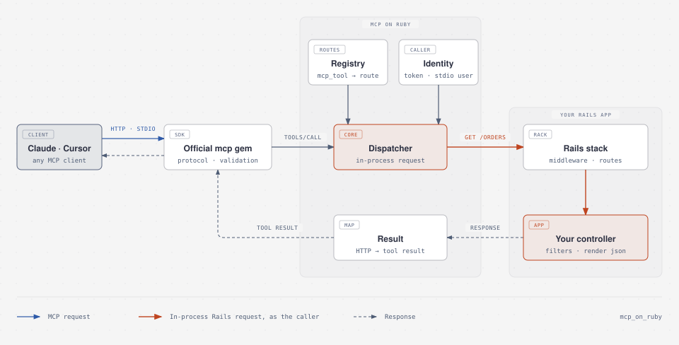

<div align="center">

# MCP on Ruby

**Make your Rails app usable by AI agents.**

Your existing controllers become [Model Context Protocol](https://modelcontextprotocol.io) tools, running through<br>
the same authentication, policies, params, and JSON you already ship.

[](https://rubygems.org/gems/mcp_on_ruby)
[](https://github.com/nagstler/mcp_on_ruby/actions/workflows/ci.yml)
[](#compatibility)
[](#compatibility)
[](LICENSE.txt)

[Quick start](#quick-start) ·
[How it works](#how-it-works) ·
[Guides](#guides) ·
[Configuration](#configuration) ·
[Testing](#testing)

</div>

---

```ruby
class OrdersController < ApplicationController
  before_action :authenticate_user!

  mcp_tool :index, description: "Search the current user's orders",
                   params: { status: { type: :string, enum: %w[pending paid shipped] } }
  mcp_tool :show,  description: "Fetch one order by id"

  def index
    render json: current_user.orders.where(params.permit(:status))
  end

  def show
    render json: current_user.orders.find(params[:id])
  end
end
```

That's the whole integration. Claude, Cursor, or any MCP client can now search and read orders **as the signed-in user**. Your `before_action` authenticates the agent, your scopes and policies decide what it can see, and your existing JSON comes back to it. You don't write new tool classes or a second permission system.

## Why MCP on Ruby

Most MCP libraries ask you to build a parallel API for agents: new tool classes, new argument parsing, new authorization checks. Over time that second API drifts from the real one, and every rule has to be secured twice.

MCP on Ruby takes the opposite approach. **Your app already has an API: your controllers.** MCP on Ruby makes it callable by agents.

- **One source of truth.** Agents go through the same routes, filters, policies, validations, and serializers as your users.
- **Real identity.** Every tool call runs as a real user, using the auth you already have: API tokens, Devise, or Warden.
- **Safe by default.** Actions that change data must be marked `write: true`, and every tool tells the client whether it is read-only or destructive.
- **Local and remote.** Serve Streamable HTTP in production, and stdio for Claude Code, Claude Desktop, and Cursor on your machine.
- **Built on the official SDK.** The protocol layer is the official [`mcp`](https://github.com/modelcontextprotocol/ruby-sdk) gem, so protocol updates arrive without a rewrite.
- **Works with the Rails you run today.** Rails 7.1 through 8.1 on Ruby 3.2+.

## Quick start

**1. Install**

```bash
bundle add mcp_on_ruby
bin/rails generate mcp_on_ruby:install
```

The generator creates `config/initializers/mcp_on_ruby.rb` and mounts the endpoint:

```ruby
# config/routes.rb
mount McpOnRuby::Engine, at: "/mcp"
```

**2. Expose some actions**

```bash
bin/rails generate mcp_on_ruby:expose products index show create
```

This adds `mcp_tool` declarations to `ProductsController`, with a params schema for `create` built from the model's columns. Edit the descriptions: they are what the agent reads. Then check what agents will see:

```console
$ bin/rails mcp:tools
TOOL             ACTION                     VERB  PATH           ACCESS
products_create  ProductsController#create  POST  /products      write
products_index   ProductsController#index   GET   /products      read-only
products_show    ProductsController#show    GET   /products/:id  read-only
```

**3. Connect an agent**

Over HTTP, sending a token your app already accepts:

```bash
claude mcp add --transport http my-app http://localhost:3000/mcp \
  --header "Authorization: Bearer $MY_APP_API_TOKEN"
```

Or locally over stdio, acting as a user you choose ([set up `stdio_user`](#authentication) first):

```bash
claude mcp add my-app -e MCP_USER=alice@example.com -- bin/rails mcp:stdio
```

Then ask: *"Which of my products cost more than $50?"*

## How it works

<p align="center">
  <picture>
    <source media="(prefers-color-scheme: dark)" srcset="docs/assets/how-it-works-dark.svg">
    
  </picture>
</p>

Each tool call becomes an ordinary request through your full middleware stack. Anything that protects your API, including `rate_limit`, Rack::Attack, tenant scoping, and audit logging, protects agent traffic too.

HTTP is served statelessly: every request is self-contained, so any Puma worker or server behind your load balancer can handle any MCP request, with no sticky sessions.

## Guides

### Declaring tools

```ruby
mcp_tool :index,
  description: "Search products by name",  # required: what the agent reads
  title: "Search products",                # optional display name
  name: "search_products",                 # optional; defaults to "products_index"
  params: {
    q:     :string,                                                  # shorthand
    sort:  { type: :string, enum: %w[name price], default: "name" },
    limit: { type: :integer, minimum: 1, maximum: 100 }
  }
```

Path parameters such as `:id` in `/products/:id` are read from your routes and added to the schema as required parameters. You don't declare them.

Use a block for nested input:

```ruby
mcp_tool :create, description: "Place an order", write: true do
  param :order, required: true do
    param :sku,      type: :string,  required: true
    param :quantity, type: :integer, minimum: 1
    param :tags,     type: :array,   items: :string
    param :note,     type: :string,  nullable: true
  end
end
```

Supported types: `:string`, `:integer`, `:number`, `:boolean`, `:array`, `:object`, `:null`, or an array of them. Options use Ruby names for JSON Schema keywords: `description`, `enum`, `default`, `format`, `pattern`, `minimum`, `maximum`, `min_length`, `max_length`, `min_items`, `max_items`, `unique_items`, and more. Unknown types and options raise immediately, so typos don't ship.

The official SDK validates arguments against this schema before your controller runs. Arguments reach `params` exactly as they would from a JSON client, so strong params work unchanged. Read tools receive them as query parameters, write tools as a JSON body.

### Authentication

MCP on Ruby never asks you to build a new auth system. It hands the caller's identity to the auth you already have.

**Over HTTP**, the client's `Authorization` header and cookies are forwarded to your controller. If your app accepts API tokens, as most API apps and Devise token setups do, there is nothing to configure.

**Over stdio** there is no HTTP request, so you choose who local sessions act as:

```ruby
# config/initializers/mcp_on_ruby.rb
McpOnRuby.configure do |config|
  # Devise / Warden apps: sign in as a user for each tool call (nothing is stored in the session).
  config.stdio_user = -> { User.find_by!(email: ENV.fetch("MCP_USER")) }

  # Token-authenticated apps: send headers your app already accepts.
  config.stdio_headers = -> { { "Authorization" => "Bearer #{ENV.fetch("MCP_TOKEN")}" } }
end
```

For Devise and Warden, the user is signed in with the `:user` scope (change it with `config.warden_scope`). Apps with custom authentication can read the stdio user with `mcp_user` in their own `before_action`.

If authentication fails, the agent gets a clear "Not authenticated (401)" tool error and nothing runs.

### Authorization

There is nothing new to learn, because tool calls run your controller code. `authorize`, `policy_scope`, `can?`, `current_user.orders.find`, and `head :forbidden` behave exactly as they do for any other client. A 403 reaches the agent as "Not permitted (403)".

Inside a controller, `mcp_request?` tells you whether an agent is calling, and `mcp_tool_name` tells you which tool:

```ruby
before_action :require_admin, if: :mcp_request?
```

### Safety

Agents act on behalf of real users, so the defaults are conservative:

- **Writes are explicit.** Declaring `mcp_tool` on an action routed with `POST`, `PUT`, `PATCH`, or `DELETE` without `write: true` raises `McpOnRuby::ConfigurationError`. This happens at boot in production and when running `bin/rails mcp:doctor`.
- **Honest hints.** Every tool is annotated from its HTTP verb (`readOnlyHint`, `destructiveHint`, `idempotentHint`), so clients like Claude can ask before destructive calls. Override with `annotations:`.
- **A kill switch.** `config.allow_writes = false` hides and refuses every write tool, for example on a read-only replica or a demo environment.
- **No accidental exposure.** Only declared actions are reachable, and declarations without a route raise. `bin/rails mcp:tools` shows exactly what is exposed.
- **No leaked internals.** Server errors reach the agent as a generic error. Details go to `Rails.error` and your logs.
- **Browser protection.** The endpoint rejects requests from foreign browser origins. Requests dispatched by MCP skip Rails' CSRF token check, which is safe because only the dispatcher can mark a request as MCP. Regular requests to the same actions stay protected.

See [SECURITY.md](SECURITY.md) for the full threat model.

### Results and errors

| Your controller returns | The agent receives |
|---|---|
| `2xx` with JSON | `structuredContent` plus the JSON as text |
| `2xx` with plain text | The text |
| `204 No Content` | A short success message |
| `401` / `403` / `404` | Tool error: not authenticated / not permitted / not found |
| `422` with JSON | Tool error including your validation messages, so the agent can correct itself |
| Other `4xx` | Tool error with the status, plus the body when it is JSON |
| `3xx` | Tool error naming the redirect target (redirects are not followed) |
| HTML | Tool error asking for JSON. Use `respond_to` with `format.json`. |
| `5xx` or an exception | Generic tool error. Details are reported to `Rails.error`, never sent. |

### Tools without a controller

For logic that has no endpoint, add a tool class from the official SDK. It runs alongside your controller tools:

```ruby
class ReindexSearchTool < MCP::Tool
  description "Rebuild the search index"

  def self.call(server_context:)
    SearchIndex.rebuild!
    MCP::Tool::Response.new([{ type: "text", text: "Reindexed" }])
  end
end

McpOnRuby.configure { |config| config.tools = [ReindexSearchTool] }
```

These tools bypass your controllers, so they also bypass your controller authentication. Use them for things that are safe for every caller.

### Observability

Every tool call emits `tool_call.mcp_on_ruby` through `ActiveSupport::Notifications`:

```ruby
ActiveSupport::Notifications.subscribe("tool_call.mcp_on_ruby") do |event|
  Rails.logger.info(
    "MCP #{event.payload[:tool]} → #{event.payload[:status]} " \
    "(#{event.payload[:transport]}, #{event.duration.round}ms)"
  )
end
```

Payload: `tool`, `controller`, `action`, `transport` (`:http` or `:stdio`), `status`, and `error`. Tool calls also show up in your normal request logs and APM traces as requests to the underlying routes.

### Connecting clients

<details>
<summary><b>Claude Code</b></summary>

```bash
# Remote or production
claude mcp add --transport http my-app https://my-app.example.com/mcp \
  --header "Authorization: Bearer $MY_APP_API_TOKEN"

# Local, over stdio (run from your app's directory)
claude mcp add my-app -e MCP_USER=alice@example.com -- bin/rails mcp:stdio
```
</details>

<details>
<summary><b>Claude Desktop</b></summary>

Claude Desktop does not load your shell profile, so start Rails through a login shell to pick up rbenv, asdf, or chruby:

```json
{
  "mcpServers": {
    "my-app": {
      "command": "bash",
      "args": ["-lc", "cd /path/to/my-app && bin/rails mcp:stdio"],
      "env": { "MCP_USER": "alice@example.com" }
    }
  }
}
```
</details>

<details>
<summary><b>Cursor</b></summary>

`.cursor/mcp.json`:

```json
{
  "mcpServers": {
    "my-app": {
      "url": "http://localhost:3000/mcp",
      "headers": { "Authorization": "Bearer YOUR_API_TOKEN" }
    }
  }
}
```
</details>

<details>
<summary><b>MCP Inspector</b></summary>

```bash
# Browse and call tools in the browser
npx @modelcontextprotocol/inspector bin/rails mcp:stdio

# Or from the command line
npx @modelcontextprotocol/inspector --cli http://localhost:3000/mcp --transport http \
  --header "Authorization: Bearer $MY_APP_API_TOKEN" --method tools/list
```
</details>

<details>
<summary><b>MCP registries and gateways</b></summary>

Register your `/mcp` endpoint with an MCP-compatible registry or gateway when you want discovery, access control, audit trails, and approvals managed centrally. Rails still owns the tools and enforces your app's own authorization on every call.
</details>

## Testing

Test tools the way agents call them: through the MCP server and your real controllers.

```ruby
# spec/rails_helper.rb
require "mcp_on_ruby/rspec"

# test/test_helper.rb
class ActiveSupport::TestCase
  include McpOnRuby::TestHelper
end
```

```ruby
it "shows agents only their own orders" do
  result = mcp_call :orders_index, { status: "pending" }, headers: { "Authorization" => "Bearer #{alice.api_token}" }

  expect(result).to be_success
  expect(result.structured.pluck("id")).to eq([alice_order.id])
end

it "stops agents from reading other users' orders" do
  result = mcp_call :orders_show, { id: bob_order.id }, as: alice   # signs in through Devise/Warden

  expect(result).to be_error
  expect(result.status).to eq(404)
end
```

`mcp_call` returns a result with `success?`, `error?`, `structured` (the parsed JSON), `status` (for failures), `text` (what the agent reads), and `protocol_error` (unknown tool, invalid arguments). `mcp_tools` lists the tool names an agent sees.

## Configuration

```ruby
# config/initializers/mcp_on_ruby.rb
McpOnRuby.configure do |config|
  config.server_name  = "my-app"
  config.instructions = "Tools for managing orders in My App. Amounts are in cents."
  config.stdio_user   = -> { User.find_by!(email: ENV.fetch("MCP_USER")) }
end
```

| Option | Default | Description |
|---|---|---|
| `server_name` | app name, dasherized | Name reported to clients |
| `server_version` | `nil` | Version reported to clients |
| `instructions` | `nil` | Guidance sent to the agent when it connects |
| `stdio_user` | `nil` | Callable returning the user `mcp:stdio` sessions sign in as (Devise/Warden) |
| `stdio_headers` | `nil` | Callable returning headers `mcp:stdio` sessions send (token auth) |
| `warden_scope` | `:user` | Warden scope used for `stdio_user` and `mcp_call(as:)` |
| `allow_writes` | `true` | Set `false` to hide and refuse every `write: true` tool |
| `tools` | `[]` | Extra `MCP::Tool` classes served alongside controller tools |
| `allowed_origins` | `[]` | Browser origins allowed to call the endpoint, in addition to same-origin |
| `max_request_bytes` | 4 MiB | Largest MCP request body accepted |
| `tool_name` | `"<controller>_<action>"` | Callable `(controller_path, action)` returning default tool names |

### Commands

| Command | What it does |
|---|---|
| `bin/rails g mcp_on_ruby:install [--path=/mcp]` | Adds the initializer and mounts the endpoint |
| `bin/rails g mcp_on_ruby:expose CONTROLLER ACTION...` | Adds `mcp_tool` declarations to a controller |
| `bin/rails mcp:tools` | Lists exposed tools, their routes, and their access level |
| `bin/rails mcp:stdio` | Serves your tools over stdio for local agents |
| `bin/rails mcp:doctor` | Checks the mount, declarations, and stdio identity; exits non-zero on errors |

## Compatibility

| | Supported |
|---|---|
| Ruby | 3.2, 3.3, 3.4, 4.0 |
| Rails | 7.1, 7.2, 8.0, 8.1 |
| MCP protocol | Every version the official `mcp` gem supports, negotiated per client |
| Transports | Streamable HTTP (stateless), stdio |
| Controllers | `ActionController::Base` and `ActionController::API` |

CI runs the full suite on every supported Ruby and Rails combination.

## When to use something else

MCP on Ruby is for exposing an **existing Rails app** to agents. Other tools fit other jobs:

- **[`mcp`](https://github.com/modelcontextprotocol/ruby-sdk)**, the official Ruby SDK, if you're building a standalone MCP server. MCP on Ruby runs on top of it.
- **[ActionMCP](https://github.com/seuros/action_mcp)** if you're on Rails 8.1+ and prefer dedicated tool, prompt, and resource classes with a full MCP feature set.
- **[Tidewave](https://tidewave.ai)** if you want coding agents to understand your codebase while you develop. MCP on Ruby is about your app's *runtime* behavior for your *users*.

## Contributing

Bug reports, ideas, and pull requests are welcome. See [CONTRIBUTING.md](CONTRIBUTING.md).

```bash
git clone https://github.com/nagstler/mcp_on_ruby && cd mcp_on_ruby
bin/setup
bundle exec rake                          # specs + RuboCop
RAILS_VERSION=7.2 bundle update && bundle exec rspec   # another Rails series
```

Release notes are in [CHANGELOG.md](CHANGELOG.md).

## License

Released under the [MIT License](LICENSE.txt).

## Acknowledgments

- The [Model Context Protocol](https://modelcontextprotocol.io) team for the specification.
- The maintainers of the official [Ruby SDK](https://github.com/modelcontextprotocol/ruby-sdk), on whose work this gem is built.
- The Rails community, whose conventions this gem tries hard not to break.
