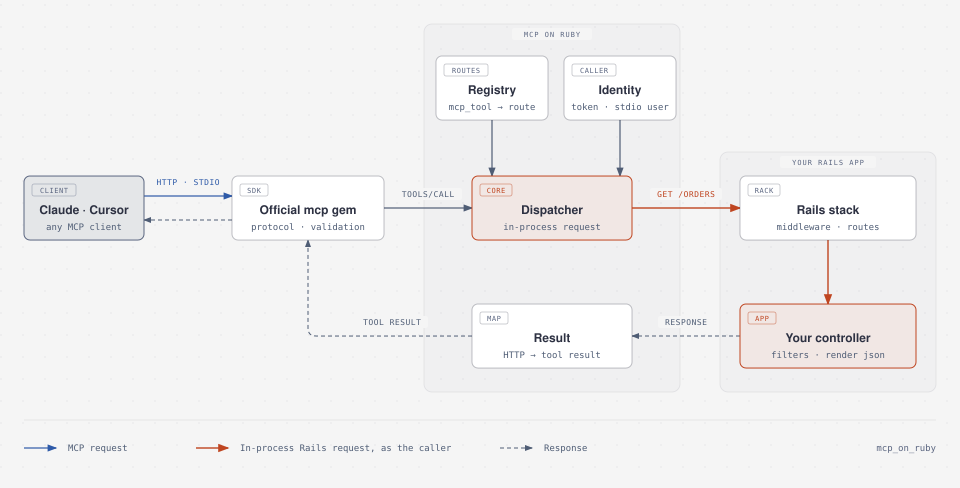

# Architecture

How a tool call travels through MCP on Ruby. Read this before changing the dispatch path. For using the gem,
start with the [README](../README.md).

  <picture>
    <source media="(prefers-color-scheme: dark)" srcset="assets/architecture-dark.svg">
    
  </picture>

## The request path

1. **Transport.** An MCP client connects over Streamable HTTP (`mount McpOnRuby::Engine`, served by
   `Endpoint`) or stdio (`bin/rails mcp:stdio`, served by `Stdio`). Both hand a `CallContext` describing
   the caller to `ServerFactory`, which builds an official `MCP::Server` for that caller.
2. **Protocol.** The official `mcp` gem negotiates the protocol version, lists tools, and validates arguments
   against each tool's input schema before any of our code runs.
3. **Registry.** `Registry` matches every `mcp_tool` declaration to its route and produces a `ToolSpec`: the
   tool name, verb, path, path params, input schema, and annotations. It raises `ConfigurationError` for
   unrouted declarations, unflagged writes, and duplicate names. It is built lazily, reset on code reload, and
   resolved at boot when eager loading.
4. **Identity.** The `CallContext` carries who is calling: the HTTP client's `Authorization` header and
   cookies, or the configured `stdio_user` / `stdio_headers`. `WardenHook` signs a stdio user in through
   Warden for the duration of one request.
5. **Dispatcher.** `Dispatcher` turns the call into an in-process request for the tool's route: path params
   fill the URL, read tools send query params, and write tools send a JSON body. It marks the request as an MCP
   request in the Rack env and runs it through `Rails.application.call`: middleware, routes, filters, and the
   controller action, exactly as any other client's request.
6. **Result.** `Result` maps the controller's Rack response to an MCP tool result: JSON becomes
   `structuredContent`, and 4xx/5xx statuses become agent-readable tool errors that never expose server
   internals.

## Where things live

| File | Responsibility |
|---|---|
| `lib/mcp_on_ruby/controller.rb` | `mcp_tool` macro, `mcp_request?`, `mcp_user`, CSRF pass-through for dispatched requests |
| `lib/mcp_on_ruby/declaration.rb`, `schema.rb` | What a controller declared, and its params compiled to JSON Schema |
| `lib/mcp_on_ruby/registry.rb`, `tool_spec.rb` | Declarations matched to routes; the `MCP::Tool` class for each |
| `lib/mcp_on_ruby/server_factory.rb` | One `MCP::Server` per caller, honoring `allow_writes` |
| `lib/mcp_on_ruby/endpoint.rb` | Stateless Streamable HTTP behind the mounted engine |
| `lib/mcp_on_ruby/stdio.rb` | stdio transport that keeps app output off the protocol stream |
| `lib/mcp_on_ruby/call_context.rb`, `warden_hook.rb` | Caller identity |
| `lib/mcp_on_ruby/dispatcher.rb`, `result.rb` | In-process dispatch and response mapping, plus `tool_call.mcp_on_ruby` instrumentation |
| `lib/mcp_on_ruby/doctor.rb`, `tool_table.rb`, `lib/tasks/` | `mcp:doctor`, `mcp:tools`, `mcp:stdio` |
| `lib/mcp_on_ruby/test_helper.rb`, `rspec.rb` | `mcp_call` / `mcp_tools` for apps' tests |
| `lib/generators/` | `mcp_on_ruby:install` and `mcp_on_ruby:expose` |

## Invariants

Changes must keep these true. [SECURITY.md](../SECURITY.md) explains why they matter.

- **Every controller tool call goes through the app's own stack.** No path skips middleware, filters, or the
  controller action.
- **Only the dispatcher marks a request as MCP.** `mcp_request?`, the stdio user, and the CSRF pass-through
  read Rack env keys; no header can set them.
- **Writes are explicit.** Non-GET routes need `write: true`, and `allow_writes = false` removes them all.
- **Server errors never reach the agent.** Details go to `Rails.error`.
- **Protocol behavior belongs to the official SDK.** Don't reimplement it here.
